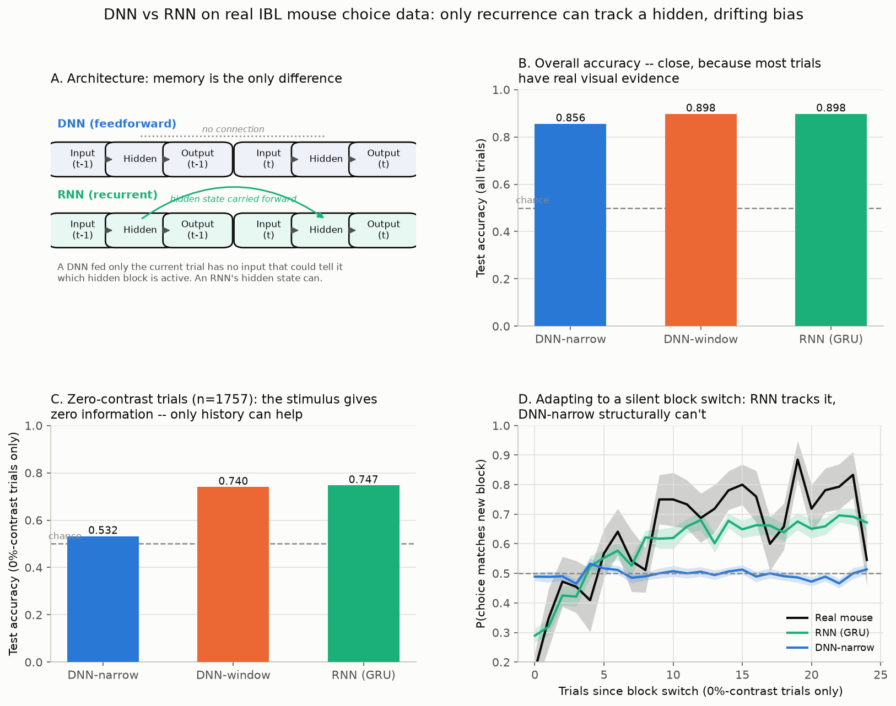

# IBL mouse decisions: explore the data, then model it

Real mouse decision-making data from the [International Brain
Laboratory](https://www.internationalbrainlab.org) (IBL), used two ways:

1. **Explore it**: a notebook with annotated plots and a desktop GUI for
   clicking through sessions, blocks and trials.
2. **Model it**: a feedforward network (DNN) can only ever see the current
   trial; a recurrent network (RNN) carries a hidden state across trials. On
   this data, that difference in *mechanism* becomes a difference in what the
   model can possibly learn.

[](https://github.com/Zhuoyang-Ye/ibl-mouse-decisions/actions/workflows/tests.yml)

## The task

IBL mice do a visual decision task: a grating appears on the left or right at
some contrast, and the mouse reports which side with a wheel turn. The prior
probability of a left-side stimulus (`probabilityLeft`) silently switches
between 0.2 and 0.8 every 20-100 trials (median about 50) -- never cued.
Trained mice track this hidden block from recent history (their own choices,
and whether they were rewarded), especially on 0%-contrast trials, where the
stimulus itself is uninformative.

A DNN fed only the current trial's stimulus has no input that could carry
block information -- it structurally cannot solve this. An RNN's hidden state
can.

## Setup

Two conda environments, because `ONE-api`/`ibllib` (database access) pin
versions that can clash with `torch`:

```bash
git clone https://github.com/Zhuoyang-Ye/ibl-mouse-decisions.git
cd ibl-mouse-decisions                       # every command below runs from here

# `ibl` env: database access, the notebook kernel and the GUI
conda create -n ibl python=3.13 && conda activate ibl
pip install -r requirements-ibl.txt
python -m ipykernel install --user --name ibl --display-name "Python (ibl)"

# torch env: the models and the test suite (on this Mac: the `code4fun` env)
conda create -n ibl-models python=3.11 && conda activate ibl-models
pip install -r requirements.txt
```

`data/ibl_trials.csv` is in the repo, so nothing needs the network unless you
want different data.

## Explore the data

Both tools run in the `ibl` env and are built on `ibl_analysis.py`, so their
numbers always agree.

- **`explore_ibl_data.ipynb`**, a notebook with five plots (session
  overview, psychometric curves by block, choices around block switches,
  trial-history effects, block lengths) plus response times. Each plot comes
  with notes on what to look for. Open it from any Jupyter install and pick
  the **Python (ibl)** kernel.
- **`ibl_explorer.py`**, a desktop GUI (PyQt5 + pyqtgraph) with the same
  analyses in tabs. It also has filters for sessions, blocks and skipped
  opening trials, a trial-by-trial session timeline, hover tooltips on every
  point, and a sortable trial table. Its "Download from the IBL database"
  panel loads any subject's sessions from OpenAlyx, and "Save CSV" writes
  them in the format the rest of the repo reads.

```bash
conda activate ibl
python ibl_explorer.py                       # or: python ibl_explorer.py other_trials.csv
```

## Model it: DNN vs RNN

The pipeline has two stages that hand off through the cached CSV:

```bash
# Stage 1 (optional; ibl env): download + cache data/ibl_trials.csv (~1 min)
python fetch_ibl_data.py

# Stage 2 (torch env): train the three models and draw the figure (~20 s on CPU, no network)
python rnn_vs_dnn_ibl.py                     # saves rnn_vs_dnn_ibl.png
```

The CSV has one row per trial: session id/index/start time, trial number,
`choice`, `contrastLeft`/`contrastRight`, `feedbackType`, `probabilityLeft`,
and `goCue_times`/`firstMovement_times`/`response_times`. The models only use
the first group; the timing columns are for the exploration tools.

| Model | Input per trial | Memory |
|---|---|---|
| `DNN-narrow` | signed contrast (current trial only) | none |
| `DNN-window` | signed contrast + last 5 trials' choice/outcome, flattened | fixed, hand-picked window |
| `RNN` (GRU) | signed contrast + previous trial's choice/outcome | unbounded, learned |

### What the figure shows

- **A** -- schematic: the only architectural difference between the DNN and
  RNN rows is whether "Hidden" at trial t-1 feeds into "Hidden" at trial t.
- **B** -- overall test accuracy: all three models do fine, because ~80% of
  trials have a real, visible stimulus.
- **C** -- accuracy on 0%-contrast trials only: `DNN-narrow` collapses to
  chance (it has no way to do otherwise); `DNN-window` and `RNN` both recover
  a large chunk of the gap using trial history.
- **D** -- the direct mechanism check: aligned to silent block switches,
  `DNN-narrow`'s predicted probability is a flat line at chance (mathematically
  guaranteed, since its only input carries no block information), while the
  RNN's prediction rises over trials-since-switch, tracking the real mouse's
  own (noisier, larger) adaptation curve.

### Results (subject `ibl_witten_12`, 40 sessions, last 8 held out)

| Model | Test accuracy (all trials) | Test accuracy (0 %-contrast) |
|---|---:|---:|
| DNN-narrow | 0.856 | 0.532 (≈ chance) |
| DNN-window (last 5 trials) | 0.898 | 0.740 |
| RNN (GRU) | 0.898 | **0.747** |



## Using different data

Either download a subject in the GUI and "Save CSV", or edit the constants at
the top of `fetch_ibl_data.py` (`SUBJECT`, `MAX_SESSIONS`) and re-run it. Any
IBL subject with the `biasedChoiceWorld` task protocol works. Everything
downstream just reads a trials CSV and doesn't care where it came from.

## Tests

```bash
pytest                                       # torch env: models + analysis (~2 s, synthetic data)
pytest tests/test_ibl_analysis.py tests/test_ibl_explorer.py   # ibl env: analysis + GUI smoke test
```

The GUI test skips itself where PyQt5/ONE-api aren't installed. GitHub
Actions runs the torch-env suite on every push.

## Repository layout

| Path | What |
|---|---|
| `fetch_ibl_data.py` | Downloads trials from OpenAlyx into `data/ibl_trials.csv` (also used by the GUI) |
| `ibl_analysis.py` | Plotting-free analysis functions shared by the notebook and the GUI |
| `explore_ibl_data.ipynb` | Exploration notebook (saved with outputs) |
| `ibl_explorer.py` | Desktop GUI |
| `rnn_vs_dnn_ibl.py` | DNN vs RNN models and the figure |
| `data/ibl_trials.csv` | 37,546 trials from 40 sessions (see [DATA_LICENSE.md](DATA_LICENSE.md)) |
| `requirements-ibl.txt` / `requirements.txt` | The `ibl` env / the torch env |
| `tests/` | pytest suite; `conftest.py` puts the repo root on the import path |

## Practice exercises

- [ ] Sweep `LAG_K` from 1 to 20 for DNN-window. Where does the gain level
      off, and how does that compare with typical block lengths?
- [ ] Give the RNN *only* the signed contrast (no previous choice/outcome).
      Can it still track the block? Why or why not?
- [ ] Replace the GRU with an LSTM, or a 1-layer Transformer with causal masking.
- [ ] Fit a classic logistic "history" model (contrast + previous choice ×
      reward) and compare it with the neural models.
- [ ] Pull a second subject (GUI download panel or `fetch_ibl_data.py`) and
      test whether a model trained on one mouse generalizes to another.
- [ ] Work through the exercises at the end of `explore_ibl_data.ipynb`, then
      add your favorite as a new tab in `ibl_explorer.py`.

## Data and license

The trials in `data/ibl_trials.csv`, and the figures and tables derived from
them, come from the IBL's public data release (Brain-Wide Map project, served
via OpenAlyx) and are shared under **CC BY 4.0**. [DATA_LICENSE.md](DATA_LICENSE.md)
lists exactly what was selected and changed, and how to credit the IBL.

The code has no open-source license yet.
